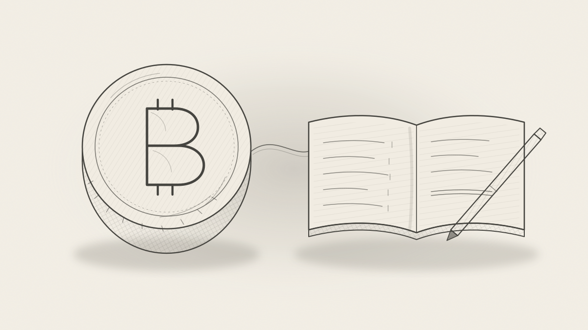

## Rivals or partners

Bitcoin and credit are usually framed as rivals: hard money against fiat. They work better as two halves of one monetary system, each solving a problem the other cannot solve alone.

Bitcoin is a scarce, liquid asset you hold before you know where, when and how much you will spend. Credit is money created by agreement once those things are known, at the moment of trade, and it is worth whatever others will accept it for. Anyone can create credit; the problem is getting it accepted.

The sections below show what breaks when either one stands alone, then what each supplies to the other.

## Bitcoin as undecided spending

Holding Bitcoin means keeping your options open: you have earned purchasing power but not yet decided what to do with it. That is a real need. Nobody knows in advance every place, moment and amount they will want to spend.

Credit serves the opposite case: spending that is already decided. A buyer who knows what they want, when, and for how much can create a credit for exactly that, today.

This gives each a clear job:

- **Bitcoin holds the undecided part.** It stores purchasing power without forcing a choice, and it stays liquid for whenever the choice comes.
- **Credit carries the decided part.** It lets those who have decided act now, without waiting for holders to make up their minds.
- **The two meet at settlement.** When a holder finally decides, they either spend BTC directly or use it to settle credit already created.

The trouble starts only when undecided money is the only money. Then every pending decision is withheld demand, and trade waits on people who have not yet chosen.

## Bitcoin alone: savings without investment

In a pure Bitcoin economy, investment does not happen structurally, because holding the money competes with every project. If 1 BTC buys more each year, an investment must beat that rise to be worth making. Investing 1 BTC to get back 1 BTC or less looks pointless, even if the remainder buys more than before.

Today the bar is extreme. Most of Bitcoin's rise comes from adoption, new buyers bidding up a fixed supply, and few real businesses can beat that. Holders gain whether or not anyone produces anything.

The deeper problem is a deadlock, known as the paradox of thrift:

- **No second baker.** If everyone holds instead of spending, the first person to open a bakery finds no customers. Going first does not help when nobody follows.
- **Falling prices do not reliably fix it.** Hoarding pushes prices down, but it also cuts jobs and output. Holders get a larger share of a smaller economy, not a richer one.
- **Debts and wages get heavier.** Debts fixed in an appreciating unit grow harder to repay, and wages are slow to fall, so falling prices mean unemployment.

When people hoard, they free real resources: labour, materials, factory time. If nothing puts those resources back to work, they sit idle. History shows where that leads: in the 1930s, countries that left the gold standard earlier generally recovered faster, and mass unemployment fed political extremism.

## Credit alone: investment without honest savings

Credit with no anchor and no exit tends to expand until it loses value, and savers pay the cost. Today's fiat system is the main example: a single state money, legal-tender laws, and limits on alternatives.

- **Debasement.** When cash loses 2 to 3 percent a year, holding it is a guaranteed loss. Savers are pushed into anything that loses less, including projects that destroy value.
- **Financial repression.** For much of the 2010s, savings in many countries paid less than inflation, and the 2021 to 2023 inflation wave made it worse.
- **Closed exits.** Restrictions and taxes on gold, foreign currency and moving money abroad leave savers few places to go. In Argentina, Lebanon and Nigeria, holding the local money has meant watching savings disappear.

So Bitcoin hoarding is often a response, not a cause. Don't blame Bitcoin hoarders; find the one who closed all other ways for them. When every other store of value is debased or blocked, people pile into the one exit left.

## What Bitcoin solves for credit

Bitcoin gives credit a limit it cannot inflate away: an honest anchor and a way out.

1. **An exit that disciplines issuers.** If a credit issuer, public or private, over-issues, holders can leave for an asset nobody can print. The threat of exit keeps issuers honest without anyone having to enforce it.
2. **A savings sanctuary.** Savers no longer need to be pushed into bad investments to escape debasement. Money that goes into projects goes there because the project is worth it, so fewer but better investments get made.
3. **An honest yardstick.** Measured against an asset with a fixed supply, it becomes visible whether credit created real value or only more units.
4. **A neutral settlement asset.** Credit networks that trade with each other must settle their net balances in something. Bitcoin is a candidate no single issuer controls, so no network has to trust another's money.

## What credit solves for Bitcoin

Credit puts back to work the resources that Bitcoin savers leave unused, without asking anyone to give up their BTC first.

1. **It breaks the deadlock.** Credit is created at the moment of trade, so the first baker's customer can pay with credit even when everyone else is holding. Nobody has to go first.
2. **It directs freed resources.** When savers hold BTC instead of spending, labour and materials are left idle. Credit lets someone else use them now, against a promise to repay.
3. **It stretches and shrinks with trade.** Credit grows when people trade and disappears when debts are repaid. A fixed supply cannot do that, especially when demand for money suddenly spikes.
4. **It keeps wages and debts in a stable unit.** Pay and loans set in a money that does not appreciate avoid both rising debt burdens and sticky-wage unemployment. A person priced out of work in BTC terms can still be hired in credit.
5. **It lowers the hurdle without forcing anyone.** Investment no longer depends on holders choosing to give up BTC's rise in value. Savers keep their sanctuary, and trade keeps its fuel.

## How the two fit together

The workable design is layered: Bitcoin holds savings and settles balances, while credit carries wages, loans and daily trade.



Each arrow is what one side supplies to the other: Bitcoin gives credit a limit, and credit gives Bitcoin's savings a use.

This already exists on a small scale. The WIR Bank in Switzerland was founded in 1934, during the Depression, by small businesses facing idle resources. Members trade on credit the network creates itself, and research has found that its use rises in recessions, when bank credit dries up.

Three questions remain open:

- **Who sits at the top?** In a panic, people flee private credit for the most trusted money. Today that is state money, because taxes must be paid in it.
- **Can Bitcoin be the settlement layer?** Credit networks would need to clear balances in BTC, which its price swings make hard during the adoption phase.
- **Where does lending BTC stop?** Banks lending BTC on fractional reserves would bring back credit expansion, bank runs and the need for a lender of last resort. Credit should be denominated in its own unit, not disguised as Bitcoin.

## Conclusion

A pure Bitcoin economy is neither possible nor desirable, because it leaves freed resources idle. A pure credit economy is unstable too, because without an exit it debases its own savers.

Together they work. Bitcoin keeps credit honest by giving savers a way out. Credit keeps Bitcoin's savings productive by putting the resources they free back to work. The useful question is not Bitcoin or fiat, but how scarce savings and trust-based credit should be combined, and who gets to issue the credit.
