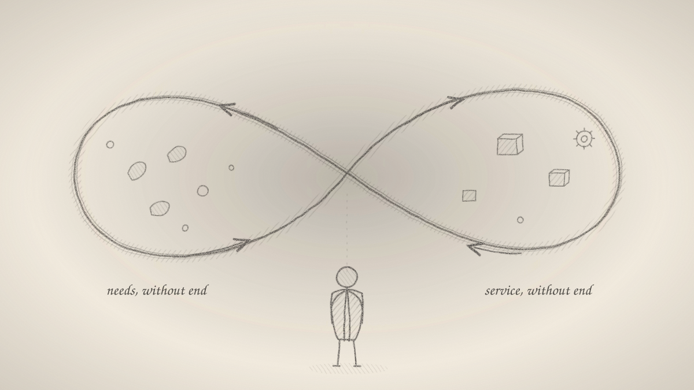

Picture the needs coming in. One person needs food, another a roof, another a fix for the code that broke this morning. Behind them more are coming, and behind those more still. Meet one need and two more grow out of it. This is the client side, and it never ends.

Now picture the ones who meet those needs. Someone cooks, someone builds, someone writes the fix. Behind them more are learning to do it, and more after them. Every answer becomes a tool for the next one. This is the service side, and it never ends either.

Put the two sides together and you get a loop. Need turns into service, and service turns into new need. Nobody started it and nobody can stop it. It was moving before you came, and it will keep moving after you leave.

So whether to do it is not a real question. The loop is going whatever you decide. You are already in it, on both sides. Every day you need something and every day you serve someone. The only question left is how you take part.

It is the same with buying. Whether to buy is not a real choice, because you cannot live without taking from the loop. What you buy is the choice. Each purchase is a vote for some way of serving, and through it you shape what the loop turns into.

And the loop needs no fuel from outside. The motion is the fuel. Need drives service and service drives need, so nobody has to push it and nobody has to keep it alive. You don't need to bring the energy; it is already there.

That changes what work is about. It is not about doing more. Nothing you add will fill something that has no end, and racing to catch up with infinity only wears you out. It is not even mostly about choosing what to do. Choosing matters, but the loop always hands you the next thing whatever you pick.

It is about experiencing the motion. Stand in front of it and look straight at it, instead of running from it or trying to swallow it whole. Facing it, the endlessness stops being a threat. It becomes a promise: there will always be someone to serve and something to receive. Nothing is short. All that is left is to be present for the turn of the loop that is in front of you now.
