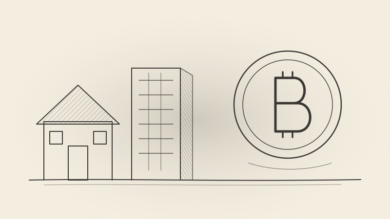

It started with a simple worry: *if people are leaving Bitcoin, the market is getting smaller — so how could the price possibly go up?*

Following that question honestly leads somewhere much more interesting than a price prediction. It leads to a question about what saving actually is, why we save in things we don't need, and why Bitcoin might be the first asset built purely for that job.

## Price is not set by the number of holders

The first thing to get straight is that a market doesn't "shrink" when people leave. Every coin someone exits with is bought by someone else. The price is set at the margin — by how eager the remaining buyers are compared with the remaining sellers — not by head count.

That's why the price can rise even while many people sell:

- **A few large buyers can outweigh many small sellers.**

- **Sellers run out.** Once the nervous holders are gone, coins sit with people who won't sell at almost any price.

- **Supply keeps tightening.** New issuance halves roughly every four years, and lost coins never come back.

"Market cap" isn't money sitting inside Bitcoin. It's just price times supply.

## A simple model: flow, holding time, and the measuring stick

Imagine buyers and sellers who are both always present. Nobody buys to hold forever; coins circulate. At any moment, the value parked in Bitcoin is roughly:

> **Value held ≈ money flowing in per period × average holding time**

Divide that by the number of coins and you have a price. In this model, the price rises only if:

1. **More money flows in** — the stream of buyers grows,

2. **People hold longer** — doubling the average holding time roughly doubles the price with no extra buyers, or

3. **Effective supply shrinks** — lost coins and slower issuance.

There is one more force: the measuring stick itself. Bitcoin is priced in fiat currency, and fiat tends to lose value over time. Even with constant real demand, the nominal price drifts upward as the currency weakens. A fuller version of the model is:

> **Price ≈ (real inflow × holding time ÷ effective supply), measured in a currency that loses value**

Debasement gives the slow drift. Shifts in demand and holding time give the large swings on top.

## We save in things we don't need

Here is the part that changes how Bitcoin looks.

Because fiat loses value, people don't keep their savings in cash. They put them into houses, stocks and other assets. Those assets then carry two kinds of demand at once:

- **Use demand** — someone needs a home to live in, or a company needs capital to make a product.

- **Savings demand** — someone just needs a place to park wealth.

The problem is that these two demands are indistinguishable. A house bought as savings looks exactly like a house bought as a home. So savings demand gets translated into real economic activity: building, hiring and producing things whose main purpose is to store wealth, not to be used. Apartments built as savings vehicles that stand empty are the clearest example. In a sense, we buy things just to buy them, and work on things just to work on them.

This is the "monetary premium": the part of an asset's price that comes from its role as savings rather than its usefulness. Housing in many cities trades well above what rents would justify, partly for this reason.

## Every economy needs one thing that produces nothing

The usual objection to Bitcoin is that it produces no income. Stocks pay dividends, property pays rent; Bitcoin only has its price.

But that objection proves less than it seems. For everything that produces income, there has to be something that doesn't: money. Cash pays nothing. Gold pays nothing. People hold them anyway, because their return is a different kind — liquidity, safety, and insurance when everything else fails.

So Bitcoin shouldn't be judged as a bad stock. It should be judged as a candidate for the non-income-producing savings role. The real question is who fills that role:

- **Fiat cash** — easy to spend and stable short-term, but it loses value over time.

- **Gold** — millennia of trust, but heavy to store and move, and its supply still grows.

- **Bitcoin** — fixed supply, borderless and self-custodied, but young and still earning trust.

Even the objection that Bitcoin can be "wrong for a decade" isn't unique. The Nikkei took about 34 years to regain its 1989 peak. Long flat periods are a feature of long-term holding in general.

## What makes Bitcoin unique

### It separates savings from production

When you save in Bitcoin, you don't create a fake demand for houses or factories. Your savings go into an asset that takes no extra resources to produce more of. Real economic activity is left to serve real needs.

### The seller is backed by use

When you buy a coin to save, the person who sells it to you usually needs the money for something real. A miner pays for electricity. An early holder buys a home or funds a company. The money doesn't vanish into Bitcoin; it flows back into the real economy through the seller, where it meets actual use demand.

### Capital recycles

Holders who sell often do so to fund businesses. If those businesses succeed, their profits come back into Bitcoin, often in excess. Bitcoin funds real activity, and real activity funds more Bitcoin.

### The holder body is permanent

Individual long-term holders come and go, but the long-term holder *class* is permanent. It forms organically and is refilled by newcomers who mature into it. Over time, this body absorbs the coins others release. That's what makes Bitcoin's mix of savers different from that of other assets: there's a committed core whose share of supply tends to grow.

### Freed resources go where they're used

If savings no longer need to be stored in buildings and businesses that exist only to hold value, the labor, time and materials behind them are freed. There may be less investment overall, but what remains is backed by use. And freed time can open new directions for breakthroughs that wouldn't have been funded otherwise.

### It grows like a destination people migrate to

Think of Bitcoin like the United States during its great migrations. People arrived with their savings, tools, companies and relationships, and every arrival made the place more attractive to the next. The more that migrate to Bitcoin, the stronger it becomes.

## Persistent, not infinite

It's tempting to say that demand for Bitcoin is infinite. It isn't, and it doesn't need to be. It is **persistent**.

Even with no new migrants, the existing holder body keeps buying out of its surplus income, and that income grows. Add fiat debasement and you have a demand that never disappears, and so a long-term upward drift. New migrants and holders reinvesting their gains provide the faster growth on top of that floor.

People who never migrate aren't the drivers of Bitcoin's price. The committed core is.

## What could still go wrong

A thesis is only as strong as the risks it has to survive. The main ones:

- **Winning the role isn't guaranteed.** Gold, fiat and other digital assets compete for the same savings.

- **Network security.** As block rewards shrink, transaction fees must eventually pay miners enough to keep the network secure. That's not yet proven.

- **Technical and custody risk.** Lost keys, hacks, failed custodians, and future threats like quantum computing that would require a coordinated upgrade.

- **Regulation and tax.** Governments can restrict Bitcoin or make it costly to hold.

- **Transition costs.** If savings shifted quickly, workers and resources tied to savings-driven production wouldn't redeploy overnight.

- **Concentration.** Large holders can still move the price sharply.

It's also worth being honest about the evidence so far. Bitcoin's long-run price growth shows that demand for Bitcoin itself has grown enormously. But at a few trillion dollars, against hundreds of trillions in real estate and stocks, it's still too small to visibly reshape how the wider economy allocates resources. That is the real test ahead.

## Conclusion

We started with a worry that people leaving Bitcoin would shrink its market. We ended somewhere else entirely:

**Bitcoin is a candidate for the non-income-producing savings role every economy needs. A committed, self-refilling holder body creates persistent demand for it. Fixed supply plus persistent demand, measured in a currency that loses value, produces a long-term upward drift — with new migrants and recycled capital adding growth on top.**

Most savings today are stored in things we build and buy just to hold value. Bitcoin offers a way to save without building. Whether the world takes that offer is still open. But the logic of why it might is clearer than the price chart alone suggests.

*This article reflects a personal view and is not financial advice.*
