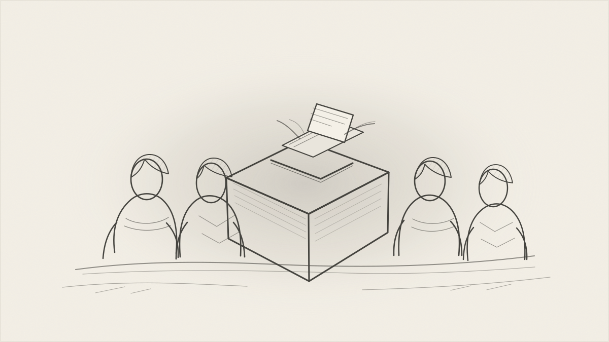

The war between Israel and Iran will not be decided by missiles or by how many commanders are killed. It will be decided by Iranians: the majority who pay for this war without knowing what it is for. In Tehran's last parliamentary election, each MP was elected with the votes of only about 3% of eligible voters. The other 97% stayed home, voted blank or chose someone else. That majority did not decide this war, yet it is the force that will settle it. Do they come against the Islamic republic?

But Iranians not wanting the government in Tehran is not enough for Israel to win. Rejecting the Islamic Republic and rising against it are not the same thing. Staying home on election day is a silent no, and a silent no does not stop the IRGC. Israel needs Iranians to come out against the IRGC and the government in Tehran. Nor is a vote withheld from the regime a vote for Israel. The 97% have not chosen a side yet.

That choice has only two outcomes. If the majority turns against the IRGC and the Islamic government, Israel wins this war. If instead they turn against Israel by standing behind the IRGC, there will be no Israel as we recognize it today. Israel's politicians agree that Iran is the number one enemy. I don't say Israel wins or loses this war; that depends on Iranians as well. But one thing is clear: Israel has started a war that could end its own existence, because it does not control all the factors needed for success. It is a gamble, all in. A country without borders is not a country: it either does not exist, or it is a superpower.

What does losing look like? A losing Iran is not a destroyed country but a fallen system: the IRGC broken, the Islamic government in Tehran gone, and with it the doctrine of hostility toward Israel. Iran itself would remain, but the likely result is years of instability as even the Islamic revolution didn't change the permanent concentration of power in a single hand. For most of its history Iran was a kingdom, and it has little tradition of a government that represents its people through voting. A losing Israel looks different. If Iranians stand behind the IRGC, Israel faces a large nation united against it, in a war with no borders and no end. Israel cannot become a superpower, and it cannot live as a country in permanent war: its economy drained, its people leaving, its society reshaped by endless mobilization. That would not be Israel as we recognize it today.

So both governments should ask themselves the same question: who are you representing? The Islamic Republic was founded on the principle that public support does not make an act legitimate, and that its absence does not make it illegitimate either. Israel's government has the backing of its own public through voting, but that does not make every act reasonable either though the majority may agree with. At its core, this is a civilizational question: those who pay for something end up deciding about it. The reverse question matters just as much: do those who decided this war really pay for it? That is a question above all for Israelis, who voted for the government that started it. The war ends only when neither Israel nor Iran sees the other as a threat. The question is not who wins. It is whether those entities who have paid for this war and/or decided about this war end it?
